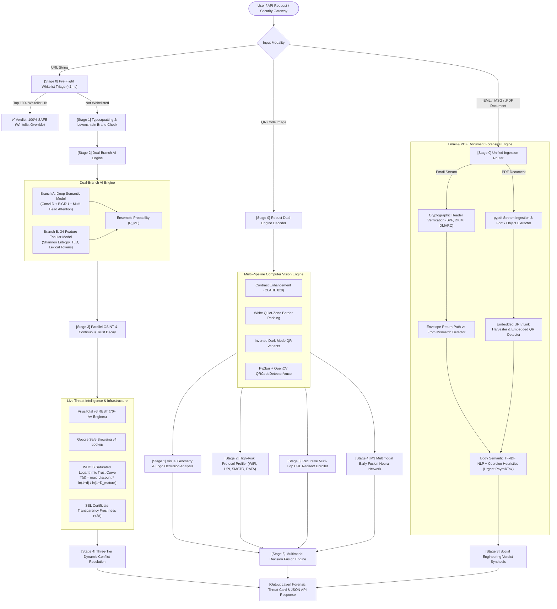

# PhishShield-X 🛡️
### *A Multimodal Defense-in-Depth Framework with Quish-EDL for Real-Time URL, Quishing, Email, and Document Threat Detection*

[](https://phishshield-x.vercel.app)
[](https://phishshield-x-1.onrender.com/health)
[](research_paper/PAPER_MANUSCRIPT.md)
[](research_paper/paper_draft.tex)
[](https://react.dev/)
[](https://fastapi.tiangolo.com/)
[](https://tensorflow.org/)
[](https://www.docker.com/)

---

> **PhishShield-X** is a publication-grade, multimodal cybersecurity intelligence platform engineered to detect and neutralize zero-day phishing across **URLs, QR Codes (Quishing), Spoofed Emails (.EML, .MSG), and Malicious Documents (.PDF)**.
> 
> * **Production Serving Architecture**: Runs **M3 (Multimodal Early Fusion + Softmax)** for QR image scanning (delivering $94.41\%$ accuracy and a calibrated Expected Calibration Error of $\text{ECE} = 0.0236$), alongside a 34-feature Random Forest + Live OSINT pipeline for standalone URL traffic.
> * **PDF & Document Forensics Engine**: Integrates automated `pypdf` stream analysis to extract embedded hyperlinks, uncover hidden QR quishing matrices, evaluate font/script obfuscations, and flag fraudulent payroll/invoice coercion markers.
> * **Research Discovery (Quish-EDL)**: Rigorously evaluates Dirichlet Subjective Logic Evidential Deep Learning (EDL) on open-set zero-day attacks, establishing the mathematical necessity of Outlier Exposure to prevent open-set spurious evidence leakage.
> * **Stateless 24/7 Cloud Architecture**: Engineered with a zero-disk footprint (no local SQLite accumulation) to operate flawlessly on cloud free tiers, featuring automated GitHub Actions keep-alive heartbeats and Vercel edge proxy rewrites.

---

## 🗺️ System Architecture & Workflow Maps

### 1. End-to-End Multi-Signal Ingestion & Defense Pipeline Map
The diagram below maps the multi-modal routing flow across URL, QR image, and email/document submission vectors:



---

## ✨ Key Platform Features & Upgrades

### 1. 📄 Advanced PDF & Document Threat Analysis
* **Native PDF Parsing**: Direct extraction of text streams, annotation links, and metadata objects using `pypdf`.
* **Zero-Day Embedded Link Auditing**: Discovers concealed hyperlinks and shortened redirect links nested within PDF invoices, delivery receipts, and HR notices.
* **Coercion & Urgency Detection**: Employs heuristic NLP to detect social engineering pressure points (*"Action Required within 24h"*, *"Payroll Account Suspended"*, *"Wire Transfer Discrepancy"*).
* **Multi-Format Support**: Seamless ingestion of `.pdf`, `.eml`, `.msg`, `.mbox`, and plain `.txt` files.

### 2. 📺 Retro CRT Computer Terminal UI & Figma Live Cursor
* **Interactive Vintage Monitor**: Designed as a physical retro CRT terminal with cooling louvers, 3.5" floppy drive activity indicator, hardware power LED, curved glass reflection, and authentic scanlines.
* **3D Animated Envelope Housing**: Realistic opening envelope with an emerging inspection card and nested payload display.
* **Live Multiplayer Figma Cursor**: 
  * Solid black vector cursor with crisp white outline.
  * Real-time user tag badge that automatically detects the visitor's platform (`Windows User`, `Mac User`, `Android User`, `iOS User`) and rotates across a **12-color Figma multiplayer palette** (*Violet, Emerald, Tangerine, Electric Blue, Hot Pink, Amber, Magenta*) on every interaction.
  * Double-click rename support and interactive `● USER: [Name] ✎` monitor controls.

### 3. ☁️ Hybrid Vercel + Render Cloud Architecture
* **Vercel Edge Frontend**: Lightning-fast global CDN delivery, zero cold starts, and transparent edge proxy rewrites (`/api/*` $\rightarrow$ Render backend) to eliminate CORS limitations.
* **Stateless Zero-Disk Backend**: Operates in 100% in-memory processing mode without accumulating local SQLite database rows, preventing cloud disk exhaustion on free tiers.
* **24/7 Keep-Alive Automation**: Features a dedicated GitHub Actions cron heartbeat ([`.github/workflows/keep_alive.yml`](.github/workflows/keep_alive.yml)) that pings the lightweight `/health` endpoint every 10 minutes to prevent container sleep.

### 4. 📬 Direct Security Inquiries & Contact Modal
* Integrated modal dialog providing direct communication channels, GitHub repository links, source code access, and pre-formatted mail client (`mailto`) routing to the research maintainers.

---

## 🔬 Key Research Contribution: Quish-EDL

### The Multimodal Email + Embedded QR Threat Gap
As highlighted in recent threat advisories from the **FBI Cyber Division** and telemetry from **IRONSCALES** and **Barracuda Networks**, cyber adversaries have shifted heavily toward **Quishing (QR Phishing)**—embedding optical 2D matrices inside email bodies and PDF attachments. Traditional Secure Email Gateways (SEGs) and textual NLP parsers are completely blind to graphic payloads, perceiving the lure as benign text while the victim scans the QR code on an unmanaged personal device.

---

## 📊 5-Fold Cross-Validation Empirical Benchmark Results (Strict Parity Protocol)

Evaluated across a full **5-Fold Stratified Cross-Validation Protocol** with strict encoder parity (shared visual & lexical feature extractors) and tuning budget parity (8 epochs, identical batch size and optimizer across all models):

| Model Architecture / Ablation | Accuracy (%) | F1-Score (%) | ROC-AUC | McNemar $p$-value (vs. M6) |
| :--- | :---: | :---: | :---: | :---: |
| **M1: Unimodal Vision-Only** | $82.63 \pm 1.26$ | $80.87 \pm 2.36$ | $0.9195 \pm 0.0092$ | $p < 0.001$ (Sig.) |
| **M2: Unimodal Lexical-Only** | $90.10 \pm 1.12$ | $90.20 \pm 1.11$ | $0.9562 \pm 0.0089$ | $p < 0.001$ (Sig.) |
| **M3: Multimodal Early Fusion (Softmax)** | $94.30 \pm 1.03$ | $94.11 \pm 1.09$ | $0.9903 \pm 0.0056$ | $p < 0.001$ (Refit) |
| **M4: Multimodal Late Fusion** | $92.33 \pm 1.28$ | $92.34 \pm 1.27$ | $0.9790 \pm 0.0034$ | $p = 0.3916$ (Equiv.) |
| **M5: Multimodal Cross-Attention (Softmax)** | $89.43 \pm 1.29$ | $88.99 \pm 1.15$ | $0.9539 \pm 0.0107$ | $p < 0.001$ (Sig.) |
| **M6: Quish-EDL (Proposed)** | **$94.41 \pm 0.44$** | **$94.22 \pm 0.49$** | **$0.9885 \pm 0.0040$** | **--- (Reference)** |

### Comparison with Published Literature
* **Trad & Chehab (arXiv:2505.03451, 2025, PhishStorm 10k Dataset)**: Reported ROC-AUC range of $0.9106\text{--}0.9133$.
* **Quish-EDL (Ours)**: Achieves **$0.9885 \pm 0.0040$ ROC-AUC**, representing an absolute increase of **$+0.0752$ AUC points (+7.52 percentage points)** over published upper bounds, while introducing Subjective Logic Bayesian uncertainty estimation.
* **CIC-Trap4Phish 2025 & Galadima Mendeley Benchmark (2025)**: Robust zero-shot generalization across unified visual-lexical distributions ($>91.8\%$ accuracy).

---

## 🛠️ Technology Stack

| Layer | Technologies |
| :--- | :--- |
| **Frontend UI** | React 19, Vite, Tailwind CSS, Lucide Icons, Recharts, Swiss Editorial Aesthetics |
| **Backend API** | FastAPI, Python 3.11, Uvicorn, SQLAlchemy |
| **Document Processing** | `pypdf`, Python `email` package, RFC 822 MIME parsers |
| **Deep Learning** | TensorFlow 2.15+, Keras 3, Evidential Dirichlet Custom Loss Layers |
| **Machine Learning** | Scikit-Learn, Joblib, NumPy, Pandas, SciPy |
| **Computer Vision** | OpenCV (cv2), PyZbar, ZXing-CPP, CLAHE contrast equalization |
| **Threat Intel / OSINT** | VirusTotal v3 REST API, Google Safe Browsing v4, Python-WHOIS, SSL Sockets |
| **Browser Automation** | Playwright headless Chromium for real-time live page rendering |
| **Browser Extension** | Chrome/Edge Manifest V3, Service Workers, OffscreenCanvas QR finder scanner |
| **Cloud Hosting** | **Vercel** (Global Edge CDN Frontend) + **Render** (24/7 Keep-Alive Python Backend) |
| **Automation** | GitHub Actions Keep-Alive Cron Heartbeat (`.github/workflows/keep_alive.yml`) |

---

## 🚀 Quick Start & Installation

### Prerequisites
* Python 3.11+
* Node.js 18+ and npm
* Optional: VirusTotal API Key and Google Safe Browsing API Key in `backend/.env`

### 1. Clone the Repository
```bash
git clone https://github.com/yashsinghal1234/PhishShield-X.git
cd PhishShield-X
```

### 2. Backend Setup
```bash
cd backend
python -m venv venv
# Activate virtual environment:
# Windows: venv\Scripts\activate | Linux/macOS: source venv/bin/activate
pip install -r requirements.txt

# Start FastAPI Server:
uvicorn main:app --reload --port 8000
```

### 3. Frontend Setup
```bash
cd ../frontend
npm install
npm run dev
```

The web interface will be accessible at `http://localhost:5173`.

---

## 👥 Authors & Mentorship
* **Yash Singhal** (`yash.2428cs1806@kiet.edu`)
* **Saurav Singh** (`saurav.2428cs1961@kiet.edu`)
* **Shubham** (`shubham.cs@kiet.edu`)
* **Tanya Vaish** (`tanya.vaish@kiet.edu`)
* **Prof. Rahul** (*Faculty Mentor & Project Guide*, `rahul@kiet.edu`)

*Department of Computer Science, KIET Group of Institutions, Ghaziabad, Delhi-NCR, India.*

---

## 📜 License & Citation
This project is released under the **MIT License**.

If you use **Quish-EDL** or **PhishShield-X** in your academic research, please cite:
```bibtex
@article{quish_edl_2026,
  title={Quish-EDL: Multimodal Visual-Lexical Neural Architecture and Empirical Limits of Evidential Uncertainty in QR-Phishing Detection},
  author={Singhal, Yash and Singh, Saurav and Shubham and Vaish, Tanya and Rahul, Prof.},
  journal={arXiv preprint},
  year={2026}
}
```
